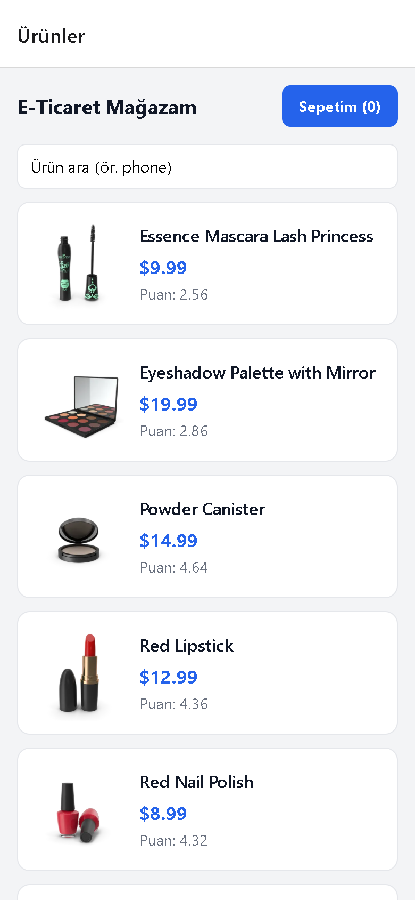
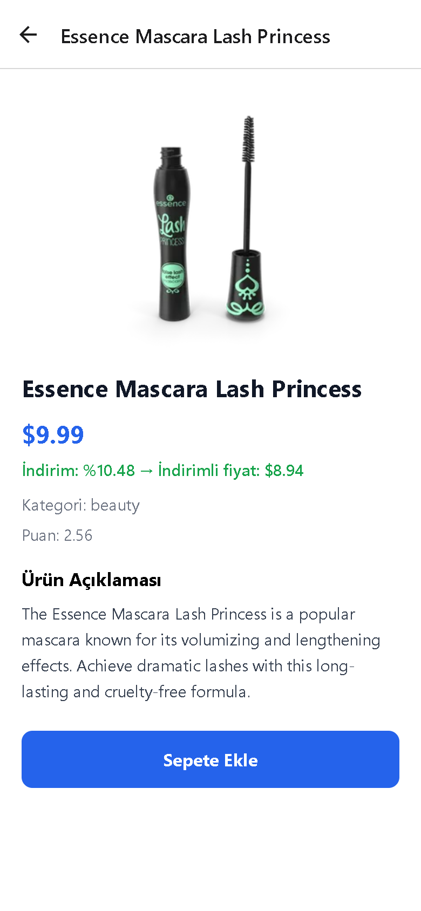
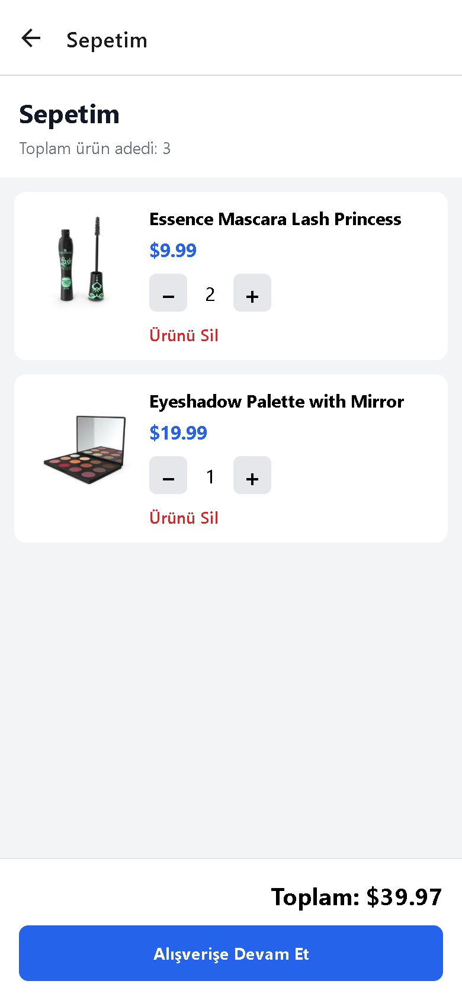
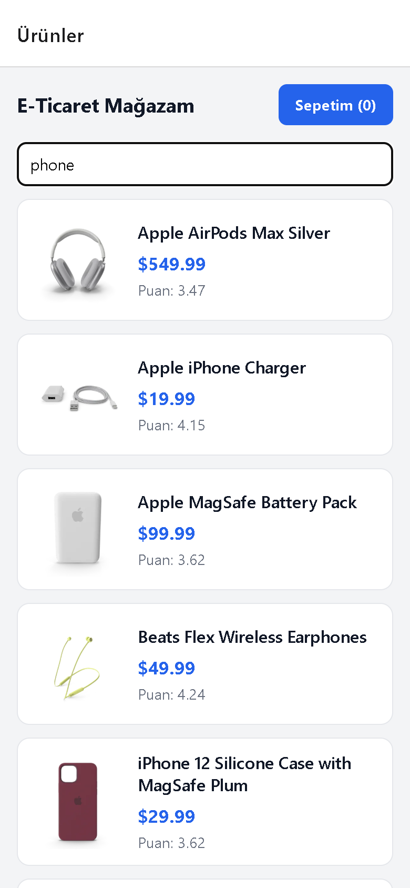

<h1 align="center">🛍️ E-Ticaret Lab</h1>

<p align="center">
  React Native ve Expo ile geliştirilmiş, gerçek bir REST API'den veri çeken üç sayfalı mobil alışveriş uygulaması.
</p>

<p align="center">
  
  
  
  
  
</p>

---

## 📸 Ekran Görüntüleri

<table>
  <tr>
    <td align="center"><b>Ürün Listesi</b></td>
    <td align="center"><b>Ürün Detayı</b></td>
    <td align="center"><b>Sepet</b></td>
    <td align="center"><b>Ürün Arama</b></td>
  </tr>
  <tr>
    <td></td>
    <td></td>
    <td></td>
    <td></td>
  </tr>
</table>

## ✨ Özellikler

- **Ürün listeleme:** [DummyJSON](https://dummyjson.com/docs/products) API'sinden `fetch` ve `async/await` ile 20 ürün çekilir ve `FlatList` ile listelenir.
- **Yükleniyor ve hata durumları:** Veri gelene kadar `ActivityIndicator` gösterilir. İstek başarısız olursa hata mesajı ve "Tekrar Dene" butonu çıkar.
- **Dinamik ürün detayı:** `/urun/[id]` rotası seçilen ürünün bilgilerini API'den ayrıca çeker. Sayfa başlığı ürün adına göre değişir.
- **Sepet yönetimi:** Ürün ekleme, adet artırma/azaltma, ürün silme ve toplam tutar hesaplama yapılabilir.
- **Ortak state:** Sepet, Context API ile tüm ekranlarda paylaşılır.
- **Ürün arama:** Arama kutusuna yazılan ifade 400 ms bekledikten sonra `/products/search` uç noktasına gönderilir.

## 🧭 Uygulama Akışı

```text
 ┌──────────────┐  ürüne dokun   ┌──────────────────┐  Sepete Ekle   ┌──────────────┐
 │  Ürünler (/) │ ─────────────▶ │ Ürün Detayı      │ ─────────────▶ │ Sepetim      │
 │  index.js    │                │ urun/[id].js     │                │ sepet.js     │
 └──────┬───────┘                └──────────────────┘                └──────┬───────┘
        │                     Sepetim (n) butonu                            │
        └──────────────────────────────────────────────────────────────────▶│
        ◀───────────────────────── Alışverişe Devam Et ─────────────────────┘

                 SepetProvider (context/SepetContext.js) tüm ekranları sarar
```

## 📁 Proje Yapısı

```text
eticaret-lab/
├── app/
│   ├── _layout.js         # Stack navigasyonu + SepetProvider
│   ├── index.js           # Ürün listesi ve arama          →  /
│   ├── sepet.js           # Sepet ekranı                   →  /sepet
│   └── urun/
│       └── [id].js        # Dinamik ürün detayı            →  /urun/5
├── components/
│   └── UrunKarti.js       # Yeniden kullanılabilir ürün kartı (props: urun, onPress)
├── context/
│   └── SepetContext.js    # Sepet state'i, işlemler ve useSepet custom hook'u
├── docs/screenshots/      # README görselleri
├── app.json               # scheme: "eticaretlab", plugins: ["expo-router"]
└── package.json           # main: "expo-router/entry"
```

## 🧠 Kullanılan Kavramlar

| Kavram | Nerede kullanıldı |
|--------|-------------------|
| **Component ve Props** | `UrunKarti` bileşeni, `urun` ve `onPress` prop'larını alır |
| **useState** | Ürün listesi, yükleniyor/hata durumları, arama metni ve sepet |
| **useEffect** | API isteğini başlatma, `[id]` ve `[arama]` değişince yeniden çekme |
| **useContext / Custom Hook** | `useSepet()` ile sepet verisine her ekrandan erişim |
| **Context API** | `SepetProvider` ile ortak sepet state'i |
| **Expo Router** | Dosya tabanlı rotalar, `useRouter`, `useLocalSearchParams` |
| **Fragment** | Detay ekranında `<Stack.Screen>` ve içeriği `<>...</>` ile gruplama |
| **Immutability** | Sepet güncellemelerinde `...spread`, `map`, `filter`, `reduce` |
| **Koşullu render** | Yükleniyor, hata ve boş sepet durumları |

## ✅ Tamamlanan Öğrenci Görevleri

| # | Görev | Dosya |
|---|-------|-------|
| 1 | Ürün kartında puan (`rating`) gösterimi | `components/UrunKarti.js` |
| 2 | Sepet butonunda toplam ürün adedi, örneğin **Sepetim (3)** | `app/index.js` |
| 3 | `discountPercentage` ile indirimli fiyat hesabı | `app/urun/[id].js` |
| 4 | Ek çalışma: `TextInput` ile ürün arama | `app/index.js` |

İndirimli fiyat formülü:

```js
indirimliFiyat = fiyat - (fiyat * indirimOrani) / 100;
```

## 🚀 Kurulum ve Çalıştırma

Gereksinimler: [Node.js LTS](https://nodejs.org/) ve telefonda **Expo Go** uygulaması.

```bash
git clone https://github.com/EylulErkaya/eticaret-lab.git
cd eticaret-lab
npm install
npx expo start --go --clear
```

Terminalde çıkan QR kodu Expo Go ile okutun. Bilgisayar ve telefon aynı ağda olmalıdır. Bağlantı kurulamazsa tunnel kullanın:

```bash
npx expo start --go --tunnel
```

## 🌐 Kullanılan API

| İstek | URL |
|-------|-----|
| Ürün listesi | `https://dummyjson.com/products?limit=20` |
| Tek ürün | `https://dummyjson.com/products/{id}` |
| Ürün arama | `https://dummyjson.com/products/search?q={ifade}` |

> **Not:** Sepet, uygulama belleğindeki React state'inde tutulur. Uygulama tamamen kapatılıp açıldığında sıfırlanır. Sepet işlemleri için API'ye istek gönderilmez.

---

<p align="center">Mobil Programlama dersi laboratuvar çalışması</p>
